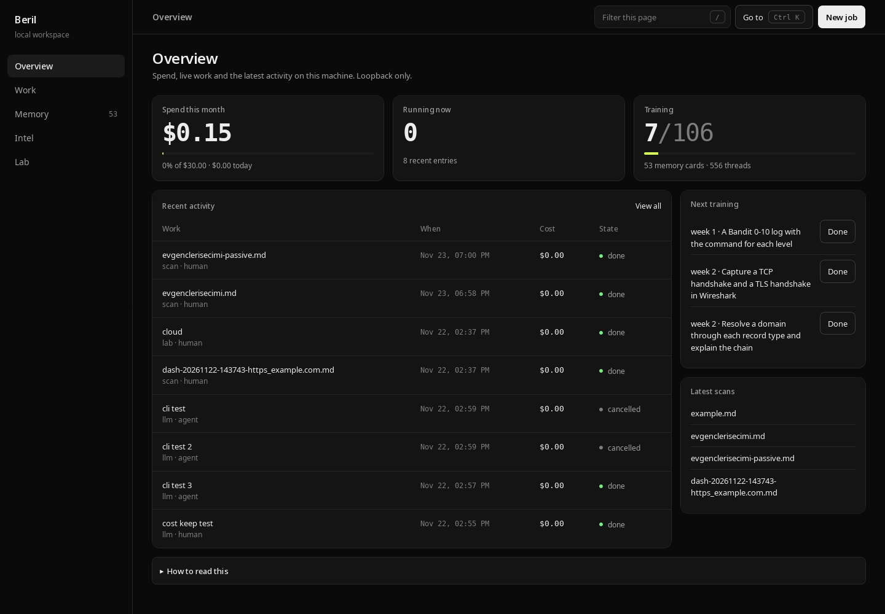

# Dashboard



A local dashboard for every catalog in Beril. Orbit-style: monochrome, thin rules, one spacing scale, flat panels, light and dark.

```bash
./beril dashboard
```

It binds `127.0.0.1:8788` and opens the browser. Use `--port` to change and `--no-open` on a headless host.

## Pages

| Page | What it shows | Action |
|---|---|---|
| Overview | Spend, ledger, counts, training queue, scans | Mark a task done |
| Activity | Jobs, labs, scans and journal in one stream | Open context |
| Jobs | Every job with actor, model, tokens and cost | Create, finish, inspect |
| Costs | Spend today/week/month, by model and type | Set the budget |
| Threads | Every harvested thread with source filter and search | Open the source |
| Experts | Profiles, focus, work count | Open the profile |
| Tools | Core shelf and RE/offense shelf, search | Open the repo |
| Methods | Extracted method notes and code density | Open the source |
| GitHub atlas | 2,064 repos by category and stars | Open the repo |
| Labs | Ten labs and last run status | Run the smoke test |
| Training | Progress, next tasks, journal | Mark done |
| Posture | Severity trend, latest target, top checks, coverage and suppressed count from local JSON | Open a target report |
| Scans | Passive scan and report viewer | Scan a URL or artifact |
| Sources | Row counts per source | Find coverage gaps |

Keyboard: `/` focuses search. Theme is stored in localStorage.

## Cost tracking

Jobs store `tokens_in`, `tokens_out`, a model and `cost_usd`. The price table is `data/llm_prices.json`; unknown models cost zero until you add a rate.

```bash
./beril job log --type llm --title "Triage CVE notes" --model claude-sonnet-4.5 \
  --tokens-in 12000 --tokens-out 800 --status done
./beril job budget --set 30
```

Scans and labs create jobs automatically with zero cost. The budget is a soft bar, not a hard stop.

## Design tokens and motion

The page uses a token layer, one skeleton (`shell`) for each page and system
fonts. Numbers use `tabular-nums`, buttons say the action ("Run scan", "Run
test"), and the table markup keeps `thead` and `tbody`.

Modern CSS in use:

- `@view-transition` and `startViewTransition` for page changes.
- `animation-timeline: view()` for a restrained reveal on cards.
- `grid-template-rows: subgrid` for aligned posture cards.
- `<details name="faq">` so only one help item is open.
- `theme-color` and `color-scheme` meta.

Reduced motion disables the reveal and the transition.

## Design

Inspired by the Polar Orbit system:

- Design by subtraction. One accent, one radius scale, no gradients.
- Derived, not decorated. Spacing and type come from a single scale.
- Precision as respect. Numbers use a mono stack, columns align.
- Card borders instead of shadows. Hover is a soft background, not a lift.
- One near-black surface scale, no theme toggle.

No framework and no build step. One Python file, one HTML string, standard library only.

## Security

- Binds loopback only.
- A random per-run token is injected into the page and required as
  `X-Beril-Token` on every POST.
- `Origin`, when present, must be the loopback origin.
- CSP, `nosniff`, `DENY` frame and `no-store` headers are set.
- Read-only reads for every GET.
- POST actions: jobs, budget, lab test and scan.
- Scan targets are passed as list arguments, never a shell string.
- Report names are matched against `^[A-Za-z0-9._-]+\.md$`.
- Lab names are checked against a fixed list.

The dashboard has no login. The token stops a random local process or a
cross-site form from firing actions, not a local user. Do not expose it beyond
loopback without a proxy and auth.

## Limits

- A scan can take up to 300 seconds and the request waits.
- The overview loads counts from JSONL on each request. Large files add latency.
- The report renderer handles headings, links, bold and code. It does not render tables.
- The dashboard does not edit catalog rows. Use the scripts for that.

## Refresh

```bash
./beril harvest forums --sources 0x00sec,reddit,hackerone
./beril harvest tools --sources canonical
./beril train --status
```
